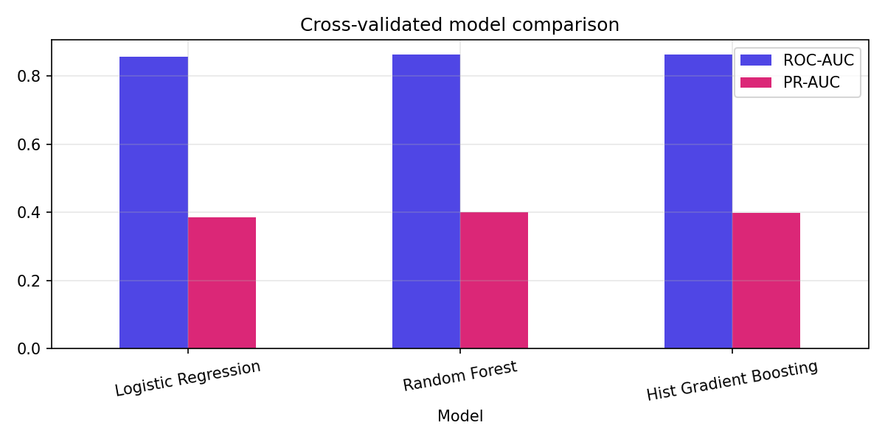
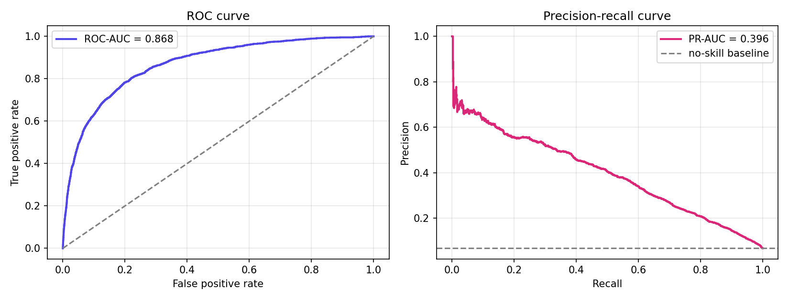
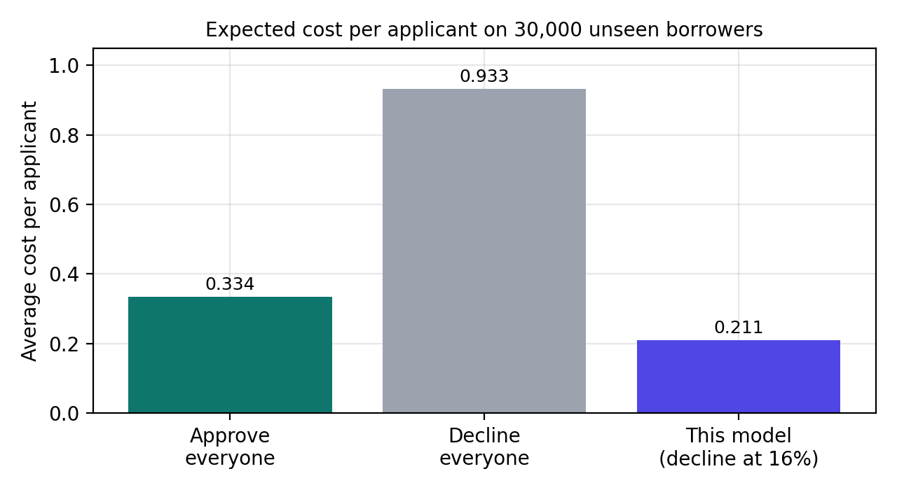
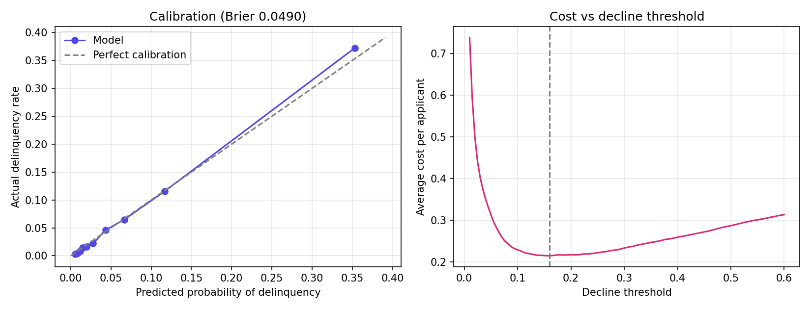
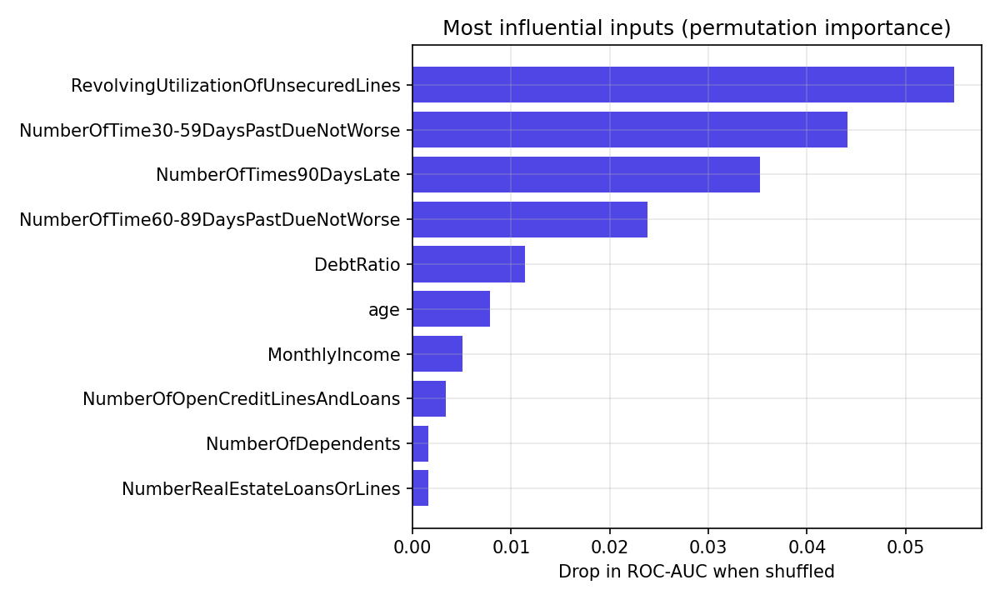
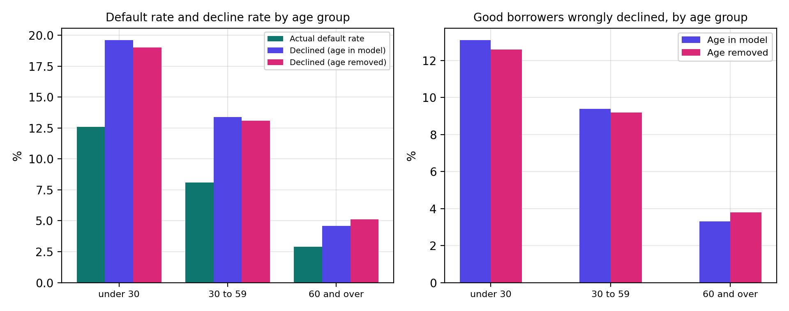
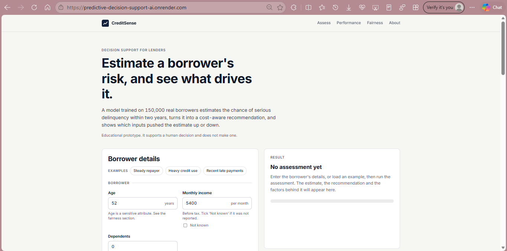
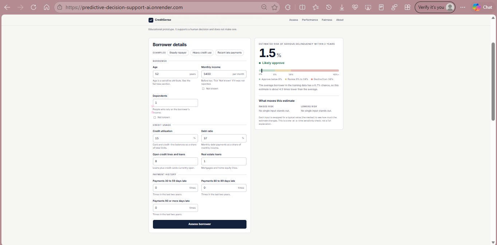

<div align="center">

# 💳 CreditSense AI
### AI-Based Predictive Decision Support System

*From 150,000 real borrowers to an explainable approve / review / decline recommendation.*

<p>
  
  
  
  
</p>
<p>
  
  
  
  
</p>

**[🚀 Live Demo](https://predictive-decision-support-ai.onrender.com)** &nbsp;|&nbsp; **[📓 Notebook](./Kaushikee_Karmakar_Project2_Predictive_Decision_Support.ipynb)** &nbsp;|&nbsp; **[📑 Full Report (PDF)](./Kaushikee_Karmakar_Project2_Report.pdf)**

</div>

---

## 🎯 Overview

CreditSense AI estimates the probability that a borrower will become **seriously delinquent (90 or more days past due) within two years**, then turns that probability into a cost-aware recommendation: **approve**, **manual review** or **decline**. Every score comes with the inputs that pushed it up or down, and the whole system was audited for differences across age groups.

It is a **decision-support** tool. It helps a human decide and is not built to approve or reject anyone on its own.

Built for the **SparkIIT AI Training and Internship Program (powered by Wipro DICE ID)**, project *AI-Based Predictive Decision Support System*.

---

## ✅ SparkIIT Brief Coverage

| Task from the project brief | How it was done |
|---|---|
| Collect and preprocess datasets | Kaggle *Give Me Some Credit*, 150,000 borrowers. Missing values, impossible ages, error codes and extreme outliers handled without leaking test data |
| Feature selection and engineering | 5 engineered features (total past-due events, ever-late flag, log income, log debt ratio, income per dependent) and ANOVA feature selection tuned inside the pipeline |
| Train multiple machine learning models | Logistic Regression, Random Forest, Hist Gradient Boosting |
| Compare model performance | 5-fold cross-validation with ROC-AUC, PR-AUC and Brier score (mean and spread) |
| Generate predictions and confidence scores | Calibrated risk probability per borrower, plus a cost-based decision threshold |
| Develop an interactive prediction interface | Custom Flask web app (HTML, CSS, JavaScript) with an input form, a risk scale with recommendation, an explanation of the drivers, and performance and fairness sections. The same interface also exists inside the notebook as the `assess()` function |

---

## 📦 Dataset

**Give Me Some Credit** (Kaggle competition): https://www.kaggle.com/c/GiveMeSomeCredit

- 150,000 real borrowers, 10 inputs, target `SeriousDlqin2yrs`
- **6.68%** of borrowers became seriously delinquent, so the classes are heavily imbalanced
- 119,999 borrowers for training and **30,000 held out for testing**
- Real-world mess: missing income and dependents, error codes (96 and 98) in the past-due columns, extreme utilization values

> The data file is **not included** in this repository. Download `cs-training.csv` from the Kaggle page above (you need a free account and must accept the competition rules).

---

## 🔄 Pipeline

```mermaid
flowchart LR
    A["📥 Kaggle data<br/>150,000 borrowers"] --> B["🧹 Clean and split<br/>before any statistics"]
    B --> C["🛠️ Engineer 5 features"]
    C --> D["🧪 Pipeline: impute, scale,<br/>select, model"]
    D --> E["🏁 Compare 3 models<br/>5-fold CV"]
    E --> F["🎯 Tune best model"]
    F --> G["💰 Cost-based<br/>decision threshold"]
    G --> H["🔍 Explain + fairness audit"]
    H --> I["🌐 Flask web app on Render"]
```



---

## 🏆 Results

### Why not accuracy?

Only 6.7% of borrowers default, so **approving everyone is already 93% accurate** while catching no defaulter at all. This project uses ROC-AUC, PR-AUC, Brier score and the **cost of decisions** instead.

### Model comparison (5-fold cross-validation, training set)

| Model | ROC-AUC | PR-AUC | Brier (lower is better) |
|---|:---:|:---:|:---:|
| Logistic Regression | 0.8560 ± 0.0069 | 0.3848 ± 0.0092 | 0.0500 ± 0.0004 |
| **Random Forest (selected)** | **0.8631 ± 0.0061** | **0.3992 ± 0.0083** | **0.0492 ± 0.0004** |
| Hist Gradient Boosting | 0.8622 ± 0.0056 | 0.3974 ± 0.0079 | 0.0492 ± 0.0004 |

<p align="center">
  
</p>

### Held-out test set (30,000 unseen borrowers)

| Metric | Value | Reference |
|---|:---:|---|
| ROC-AUC | **0.8681** | 0.5 is random ranking |
| PR-AUC | **0.3956** | 0.0668 for a model with no skill |
| Brier score | **0.0490** | 0.0623 when everyone gets the average risk |

<p align="center">
  
</p>

### What the decision rule achieves

Decline when the predicted risk is **16% or higher** (manual review from 8%). The threshold minimizes an *assumed* cost in which approving a borrower who later defaults is 5 times worse than declining a good one.

| Result on 30,000 unseen borrowers | Value |
|---|:---:|
| Borrowers declined | 11.0% |
| Default rate among **approved** borrowers | **3.1%** (overall: 6.7%) |
| Default rate among declined borrowers | 35.4% |
| Share of all defaulters caught | 58.2% |
| Average cost per applicant: approve everyone / decline everyone / **this model** | 0.334 / 0.933 / **0.211** |

<p align="center">
  
</p>

<p align="center">
  
</p>

### 🔍 Key findings

- **Random Forest and Gradient Boosting are effectively tied.** They differ by 0.0009 ROC-AUC, far less than the fold-to-fold spread of about 0.006. Tuning changed almost nothing.
- **No sign of overfitting.** Test ROC-AUC (0.868) is within about one standard deviation of cross-validation (0.863).
- **The decision rule is worth it.** Under the assumed 5:1 cost ratio, expected cost per applicant falls **37%** below the best policy without a model. The cost ratio is an assumption, and a real lender would use its own figures.
- **Past-due history and credit utilization dominate** the risk estimate. The late-payment columns are correlated, so their individual importances understate how much payment history matters as a group.

<p align="center">
  
</p>

---

## ⚖️ Fairness Audit (Age)

The data has no sex or race column, but **age** is present and is a sensitive attribute in lending. Decisions on the 30,000 test borrowers were compared across three age groups, with and without age in the model.

| Age group | n | Actual default | Mean predicted risk | Declined | Good borrowers wrongly declined | Defaulters caught |
|---|---:|:---:|:---:|:---:|:---:|:---:|
| under 30 | 1,803 | 12.6% | 11.3% | 19.6% | 13.1% | 64.3% |
| 30 to 59 | 18,546 | 8.1% | 7.9% | 13.4% | 9.4% | 58.9% |
| 60 and over | 9,651 | 2.9% | 3.4% | 4.6% | 3.3% | 49.5% |

*(Age included in the model. The report also shows the same table with age removed.)*

<p align="center">
  
</p>

- **Predictions match reality on average in every group**, so the model is not simply over-penalizing one group.
- **The burden of errors is uneven:** 13.1% of good borrowers under 30 were declined versus 3.3% of those aged 60 and over, about four times as often.
- **Removing age does not fix it.** ROC-AUC drops by only 0.004 and decline rates barely move, most likely because other inputs act as proxies for age (this explanation was not tested directly).
- This is an audit, **not a legal compliance review**. Which fairness criterion is acceptable is a policy and legal decision.

---

## 🖥️ The App

- 🧮 Enter a borrower's details and get the **estimated risk, a recommendation on a risk scale and a "what moves this estimate" breakdown**
- ❓ Mark income or dependents as **not known**, as real applications often are
- 🧪 One-click example borrowers to try the tool quickly
- 📊 A performance section with test metrics, the decision rule results and the model comparison
- ⚖️ A fairness section with the age audit and honest limits
- ⚠️ Sensitive attributes are flagged wherever they influence a score
- 📱 Responsive layout, and the app stores nothing you enter

<p align="center">
  
  
</p>

> The live demo runs on a free Render instance, which sleeps when idle. The first load can take a minute.

---

## 🗂️ Repository Structure

```
Predictive-Decision-Support-AI/
├── app.py                          # Flask backend (prediction API and page)
├── templates/
│   └── index.html                  # Page layout
├── static/
│   ├── style.css                   # Styling
│   └── app.js                      # Form, results and charts logic
├── credit_model.joblib             # Saved pipeline and app metadata
├── requirements.txt                # Python dependencies
├── Kaushikee_Karmakar_Project2_Predictive_Decision_Support.ipynb   # Executed notebook with all outputs
├── Kaushikee_Karmakar_Project2_Report.pdf                        # Project report (PDF)
├── assets/                         # Figures and screenshots used in this README
└── README.md
```

---

## ⚙️ Run It Yourself

**Run the app locally**
```bash
git clone https://github.com/KK-Dev0/Predictive-Decision-Support-AI.git
cd Predictive-Decision-Support-AI
pip install -r requirements.txt
python app.py
```
Then open http://localhost:5000

**Retrain the model:** download `cs-training.csv` (or the Kaggle zip) from the dataset page, open `Kaushikee_Karmakar_Project2_Predictive_Decision_Support.ipynb` in [Google Colab](https://colab.research.google.com), choose Runtime > Run all, and upload the file when asked. The last cells export `credit_model.joblib`.

**Deploy on Render**
- Build command: `pip install -r requirements.txt`
- Start command: `gunicorn app:app --workers 1 --threads 2 --timeout 60`
- Set the `PYTHON_VERSION` environment variable, and pin `scikit-learn` in `requirements.txt` to the version used to train the model.

---

## 🧰 Tech Stack

| Area | Tools |
|---|---|
| Language | Python |
| ML | scikit-learn: Logistic Regression, Random Forest, Hist Gradient Boosting, GridSearchCV, feature selection |
| Data and plots | pandas, NumPy, Matplotlib |
| App and deployment | Flask, HTML, CSS, JavaScript, Gunicorn, Render, GitHub |
| Environment | Google Colab |

---

## ⚠️ Limitations and Future Work

- The data is anonymized US consumer data from around 2011. The model cannot be assumed to work for other countries or time periods.
- The target is serious delinquency, not profit, and the **5:1 cost ratio is an assumption**. A sensitivity analysis over several ratios would show how the threshold moves.
- Final numbers come from one train/test split, although cross-validation agrees closely with it.
- Next steps: recalibrate probabilities (isotonic regression), add SHAP explanations, test fairness-aware thresholds, validate on later data and monitor for drift.
- **Not for real lending.** A production system would need legal review, richer data and human oversight.

---

## 👩‍💻 Author

**Kaushikee Karmakar**
BCA Student, Asansol Engineering College
GitHub: [@KK-Dev0](https://github.com/KK-Dev0)

## 🙏 Acknowledgments

- **SparkIIT** and **Wipro DICE ID** for the AI training and internship program
- **Kaggle** and the organizers of the *Give Me Some Credit* competition for the dataset
- The scikit-learn and Flask open-source communities

<div align="center">

⭐ If you found this project useful, consider giving the repo a star.

</div>
